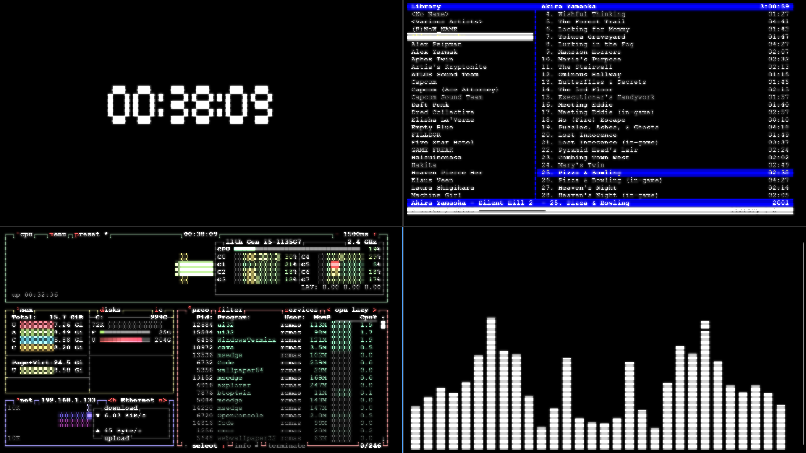

# TClock

## Usage:
Just... Open a clock.exe?

## Config
The configuration file is located at %USERPROFILE%\\.clock\config.ini

I think the configuration file for UNIX systems will be located in ~/.clock/config.ini

## Building
Since I'm planning to make an installer for this (which is necessary to publish it on winget), I'll probably write a bat script or something like that. However, you can currently build it using the simple "make" command. It doesn't have any dependencies, so you can find everything you need in the standard gcc package.

## Installing (Linux only)
Run `sudo make install` to build and install the clock to `/usr/local/bin`.
Use `make install PREFIX=$HOME/.local` to install it for the current user instead.
On non-Linux systems `make install` only builds the clock and prints a warning.
